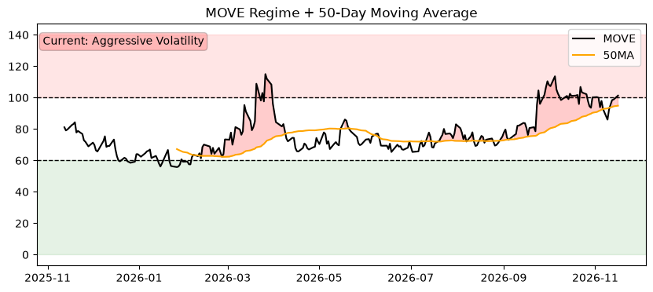
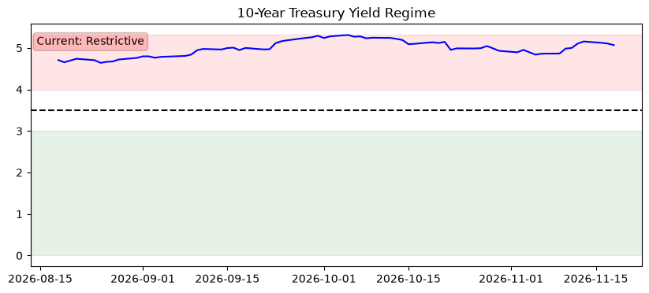

# Market Risk Monitor

**🔴 Downturn Risk**  
**Score:** Downturn 2/3 | Recovery 0/3  
**Last Updated:** 2026-11-19

---

⚠️ **Disclaimer**

This is an automated market signal summary for informational purposes only.
It is not financial advice.

A note from the author:
There are hundreds of resources on the Internet in addition to learning resources available through your investment platform.
For example, [this one by Ramit Sethi](https://youtu.be/FF5-FbhaAyc?si=52cXbGUBFqxifu7Q), or [this one by Jaspreet Singh](https://youtu.be/qdqLIjszqy4?si=-R0Sa7C_Q0bCHY08), or [this one by Erin Moriarity](https://youtu.be/FYMfX3Aljow?si=MPQ7nICG0nA1U6vh), or articles like [this one by Fidelity](https://www.fidelity.com/learning-center/smart-money/roth-ira-taxes).
Seek out the information you need for your future self!

---

## AI Risk Commentary

- SPY price (730.2) is 2.35 points below its 200-day moving average (732.55), a -0.32% deviation
- QQQ price (659.51) is 53.25 points below its 100-day moving average (712.76), a -7.47% deviation
- ARKK three-month return of -17.57% coincides with TNX yield at 5.05%, reflecting high-duration equity sensitivity to the annualized risk-free rate
- VIX level of 24.56 implies 30-day annualized volatility expectation of ~24.6%, consistent with both indices trading below their respective moving averages
- Mortgage rate at 7.28% (condition: Unfavorable) exceeds TNX yield by 223 basis points, tightening consumer credit capacity relative to the 10-year baseline
- Income spread: S&P 500 dividend yield (1.0

---

## Charts

### SPY Trend

### QQQ Trend

### ARKK Drawdown

### VIX

### MOVE

### 10Y Yield

### Oil Volatility

### Mortgage Conditions

### SPY Trailing Dividend Yield (proxy)

---

[View raw data](data/market_snapshot.json)

---

## RSS Feed

https://raw.githubusercontent.com/krss-llc/market-summary/refs/heads/main/docs/feed.xml

---

## Data

- Signals: [data/signals.json](data/signals.json)  
- History: [data/history.json](data/history.json)
