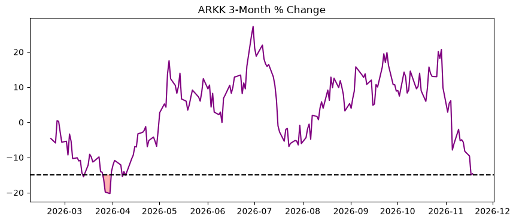

# Market Risk Monitor

**🔴 Downturn Risk**  
**Score:** Downturn 3/3 | Recovery 0/3  
**Last Updated:** 2026-11-21

---

⚠️ **Disclaimer**

This is an automated market signal summary for informational purposes only.
It is not financial advice.

A note from the author:
There are hundreds of resources on the Internet in addition to learning resources available through your investment platform.
For example, [this one by Ramit Sethi](https://youtu.be/FF5-FbhaAyc?si=52cXbGUBFqxifu7Q), or [this one by Jaspreet Singh](https://youtu.be/qdqLIjszqy4?si=-R0Sa7C_Q0bCHY08), or [this one by Erin Moriarity](https://youtu.be/FYMfX3Aljow?si=MPQ7nICG0nA1U6vh), or articles like [this one by Fidelity](https://www.fidelity.com/learning-center/smart-money/roth-ira-taxes).
Seek out the information you need for your future self!

---

## AI Risk Commentary

- SPY price = 689.81; MA200 = 732.76; price is 42.95 points (5.86%) below MA200.  
- QQQ price = 608.45; MA100 = 710.68; price is 102.23 points (14.38%) below MA100.  
- ARKK three-month change = -25.65%; reported price return over the observation period, isolated from yield mechanics.  
- VIX level = 35.89; index reading in percentage points.  
- OVX level = 54.12; regime labeled "low", index reading in comparable volatility units.  
- TNX yield = 4.91%; annualized 10-year Treasury yield baseline.  
- Mortgage rate = 7.28%; condition labeled "Unfavorable".  
- Income spread: sp_div_yield = 1.1%; ten_year_yield = 5.04%; spread calculated as 1.1 - 5.04 = -3.94 percentage points. The negative spread mathematically places bond yields above equity dividend yields on the given baseline.  

The dataset provides quantified price deviations from moving averages, annualized yield baselines, and index-level volatility readings. ARKK return is a standalone period metric. Yield values operate on an annualized basis. The income spread mechanically quantifies the difference between equity dividend yield and 10-year Treasury yield, producing a negative value that places bond yields above equity dividends. Mortgage rate is reported at 7.28 with the stated condition label. Volatility indexes are reported at their given levels and regimes. All descriptions reflect calculated relationships between the provided data points without predictive interpretation. Raw data is available in /data.

---

## Charts

### SPY Trend

### QQQ Trend

### ARKK Drawdown

### VIX

### MOVE

### 10Y Yield

### Oil Volatility

### Mortgage Conditions

### SPY Trailing Dividend Yield (proxy)

---

[View raw data](data/market_snapshot.json)

---

## RSS Feed

https://raw.githubusercontent.com/krss-llc/market-summary/refs/heads/main/docs/feed.xml

---

## Data

- Signals: [data/signals.json](data/signals.json)  
- History: [data/history.json](data/history.json)
