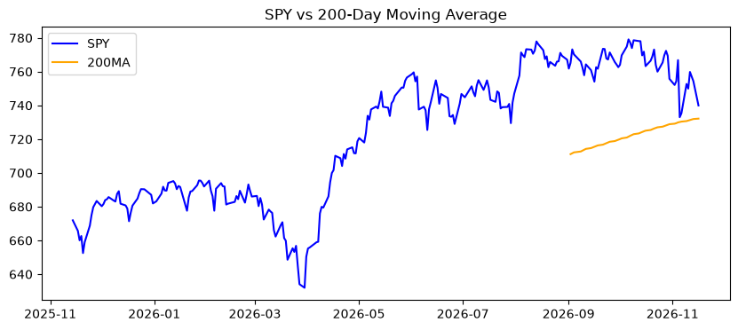
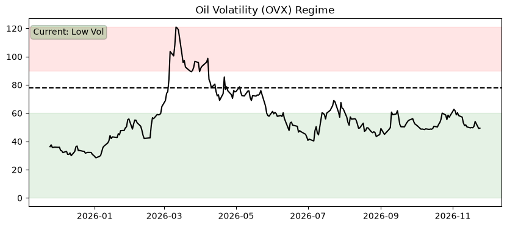
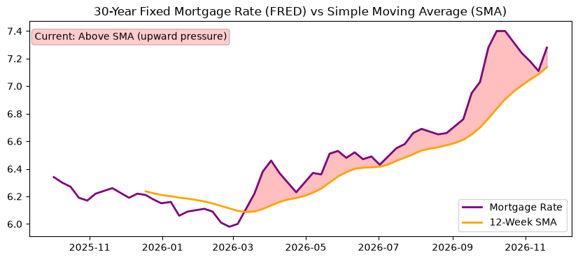
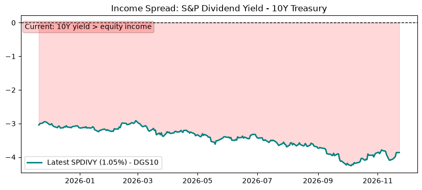

# Market Risk Monitor

**🔴 Downturn Risk**  
**Score:** Downturn 3/3 | Recovery 0/3  
**Last Updated:** 2026-11-25

---

⚠️ **Disclaimer**

This is an automated market signal summary for informational purposes only.
It is not financial advice.

A note from the author:
There are hundreds of resources on the Internet in addition to learning resources available through your investment platform.
For example, [this one by Ramit Sethi](https://youtu.be/FF5-FbhaAyc?si=52cXbGUBFqxifu7Q), or [this one by Jaspreet Singh](https://youtu.be/qdqLIjszqy4?si=-R0Sa7C_Q0bCHY08), or [this one by Erin Moriarity](https://youtu.be/FYMfX3Aljow?si=MPQ7nICG0nA1U6vh), or articles like [this one by Fidelity](https://www.fidelity.com/learning-center/smart-money/roth-ira-taxes).
Seek out the information you need for your future self!

---

## AI Risk Commentary

- SPY price 718.78 is trading below its 200-day moving average (733.04), a deviation of approximately 1.95%, indicating the current price level is beneath the trailing annual average.  
- QQQ price 638.1 is trading below its 100-day moving average (709.22), a deviation of approximately 10.0%, indicating the current price level is beneath the trailing trend baseline.  
- ARKK three-month change of -22.8% reflects a significant capital depreciation metric over the recent quarter period.  
- VIX level 26.36 represents the current implied volatility regime for S&P 500 index options.  
- TNX yield 4.85 provides the annualized nominal baseline for comparable tenor.  
- OVX level 49.39 with regime "low" indicates the current implied volatility state for Nasdaq 100 index options is classified as low.  
- Mortgage rate 7.21 with condition "Unfavorable" represents the current borrowing cost metric as labeled in the dataset.  
- Income spread: SP dividend yield 1.06% vs 10-year yield 4.91%, resulting in a spread of -3.85 percentage points. The negative spread mechanically means the 10-year Treasury yield exceeds the SP dividend yield by 3.85 percentage

---

## Charts

### SPY Trend

### QQQ Trend

### ARKK Drawdown

### VIX

### MOVE

### 10Y Yield

### Oil Volatility

### Mortgage Conditions

### SPY Trailing Dividend Yield (proxy)

---

[View raw data](data/market_snapshot.json)

---

## RSS Feed

https://raw.githubusercontent.com/krss-llc/market-summary/refs/heads/main/docs/feed.xml

---

## Data

- Signals: [data/signals.json](data/signals.json)  
- History: [data/history.json](data/history.json)
