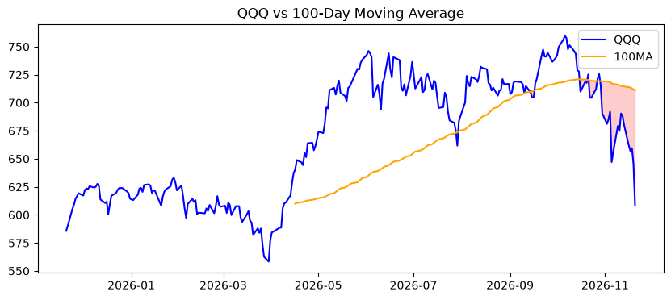

# Market Risk Monitor

**🔴 Downturn Risk**  
**Score:** Downturn 3/3 | Recovery 0/3  
**Last Updated:** 2026-11-23

---

⚠️ **Disclaimer**

This is an automated market signal summary for informational purposes only.
It is not financial advice.

A note from the author:
There are hundreds of resources on the Internet in addition to learning resources available through your investment platform.
For example, [this one by Ramit Sethi](https://youtu.be/FF5-FbhaAyc?si=52cXbGUBFqxifu7Q), or [this one by Jaspreet Singh](https://youtu.be/qdqLIjszqy4?si=-R0Sa7C_Q0bCHY08), or [this one by Erin Moriarity](https://youtu.be/FYMfX3Aljow?si=MPQ7nICG0nA1U6vh), or articles like [this one by Fidelity](https://www.fidelity.com/learning-center/smart-money/roth-ira-taxes).
Seek out the information you need for your future self!

---

## AI Risk Commentary

- SPY price = 689.81, MA200 = 732.76, deviation = -5.86%.
- QQQ price = 608.45, MA100 = 710.68, deviation = -14.35%.
- ARKK three-month change = -25.65%.
- VIX level = 35.89. OVX level = 54.12, regime = "low".
- TNX yield = 4.92%. SP dividend yield = 1.05%. Income spread = 1.05 - 4.92 = -3.87 percentage points; regime = "Bond Yield Advantage".
- Negative income spread means SP dividend yield is below 10-year yield by 3.87 percentage points. The income spread favors bonds over equities.
- Mortgage rate = 7.28%, condition = "Unfavorable". Mortgage rate minus TNX = 7.28 - 4.92 = 2.36 percentage points.

Synthesis:
The current math indicates that equity prices are below long-term moving averages, ARKK shows a -25.65% three-month price change, and VIX is at 35.89. The income spread is -3.87 percentage points, placing it in the Bond Yield Advantage regime and favoring bonds over equities. TNX is at 4.92%, mortgage condition is "Unfavorable" at 7.28%, and OVX regime is "low".

Time horizon clarity: TNX, mortgage rate, and income spread are yield/contract-based measures; SPY, QQQ, and ARKK are price-based measures.

Raw data is available in /data.

---

## Charts

### SPY Trend

### QQQ Trend

### ARKK Drawdown

### VIX

### MOVE

### 10Y Yield

### Oil Volatility

### Mortgage Conditions

### SPY Trailing Dividend Yield (proxy)

---

[View raw data](data/market_snapshot.json)

---

## RSS Feed

https://raw.githubusercontent.com/krss-llc/market-summary/refs/heads/main/docs/feed.xml

---

## Data

- Signals: [data/signals.json](data/signals.json)  
- History: [data/history.json](data/history.json)
