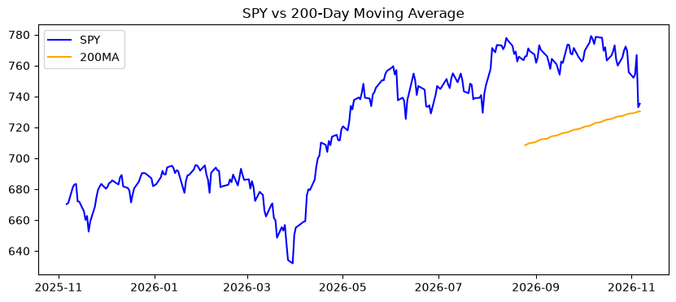
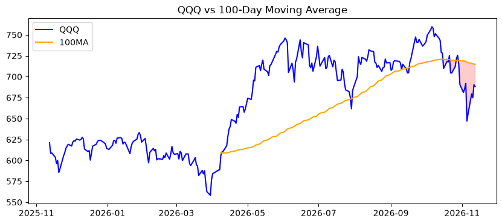
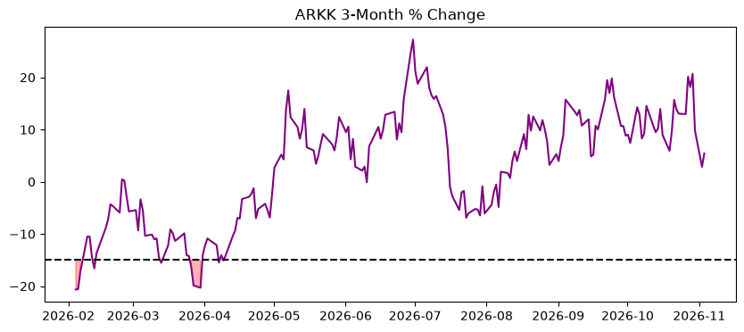
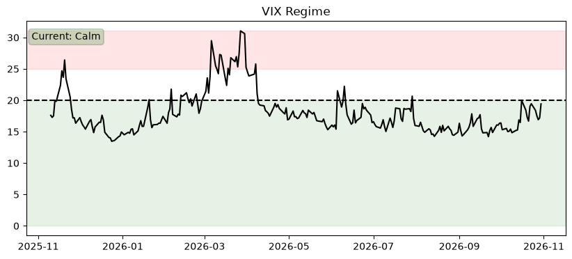
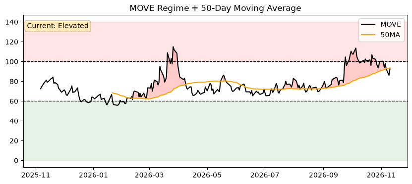
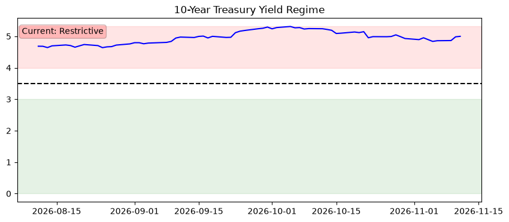
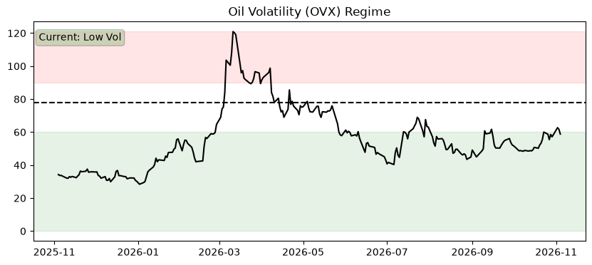
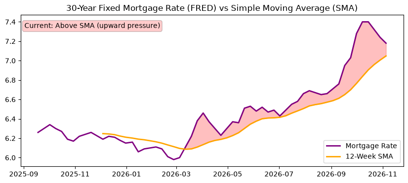
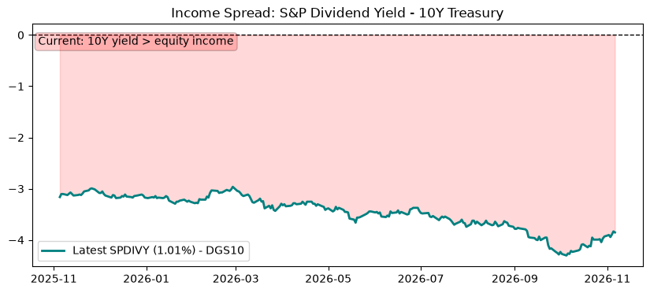

# Market Risk Monitor

**🟢 Recovery**  
**Score:** Downturn 0/3 | Recovery 2/3  
**Last Updated:** 2026-11-11

---

⚠️ **Disclaimer**

This is an automated market signal summary for informational purposes only.
It is not financial advice.

A note from the author:
There are hundreds of resources on the Internet in addition to learning resources available through your investment platform.
For example, [this one by Ramit Sethi](https://youtu.be/FF5-FbhaAyc?si=52cXbGUBFqxifu7Q), or [this one by Jaspreet Singh](https://youtu.be/qdqLIjszqy4?si=-R0Sa7C_Q0bCHY08), or [this one by Erin Moriarity](https://youtu.be/FYMfX3Aljow?si=MPQ7nICG0nA1U6vh), or articles like [this one by Fidelity](https://www.fidelity.com/learning-center/smart-money/roth-ira-taxes).
Seek out the information you need for your future self!

---

## AI Risk Commentary

- **SPY**: Current price 752.69 is above the 200‑day moving average of 730.7, indicating the 200‑day average price is lower than the present market price.  
- **QQQ**: Current price 679.35 is below the 100‑day moving average of 716.15, indicating the 100‑day average price is higher than the present market price.  
- **ARKK**: Three‑month change is –2.94 %, reflecting a decline of 2.94 % over the preceding three months.  
- **VIX**: Level stands at 19.46, providing a snapshot of implied volatility.  
- **OVX**: Level 53.1 with a “low” regime designation reflects current options‑volatility conditions.  
- **TNX**: 10‑year Treasury yield is 4.98 %.  
- **Income spread**: SP dividend yield 1.01 % minus 10‑year yield 4.88 % equals –3.87 %; the negative spread means the 10‑year yield exceeds the dividend yield by 3.87 percentage points, giving bonds a higher yield relative to equities.  
- **Mortgage**: Rate is 7.18 % with an “Unfavorable” condition, indicating financing

---

## Charts

### SPY Trend

### QQQ Trend

### ARKK Drawdown

### VIX

### MOVE

### 10Y Yield

### Oil Volatility

### Mortgage Conditions

### SPY Trailing Dividend Yield (proxy)

---

[View raw data](data/market_snapshot.json)

---

## RSS Feed

https://raw.githubusercontent.com/krss-llc/market-summary/refs/heads/main/docs/feed.xml

---

## Data

- Signals: [data/signals.json](data/signals.json)  
- History: [data/history.json](data/history.json)
