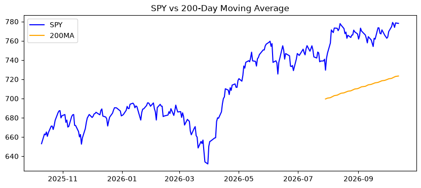
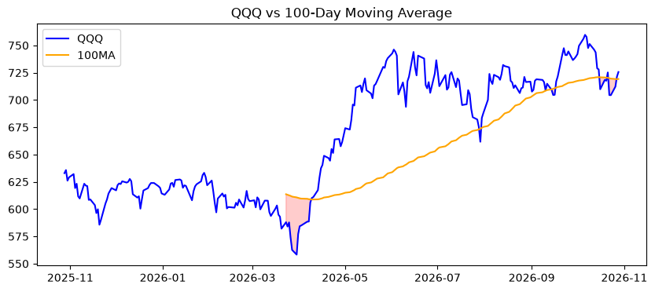
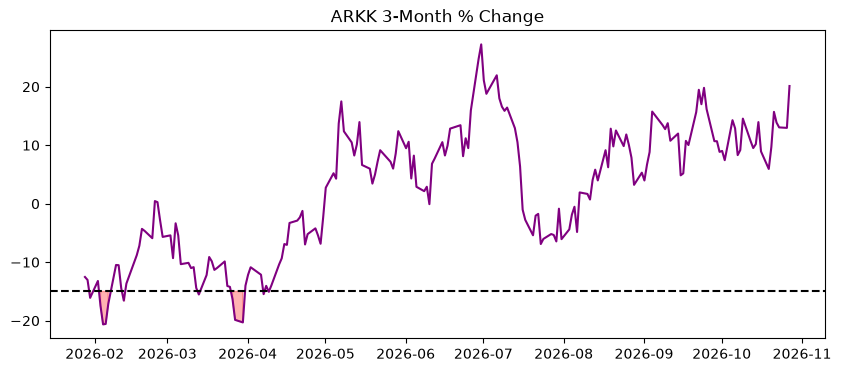
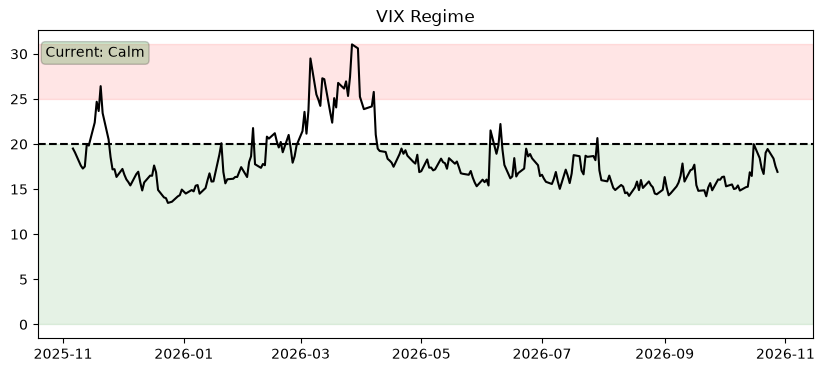
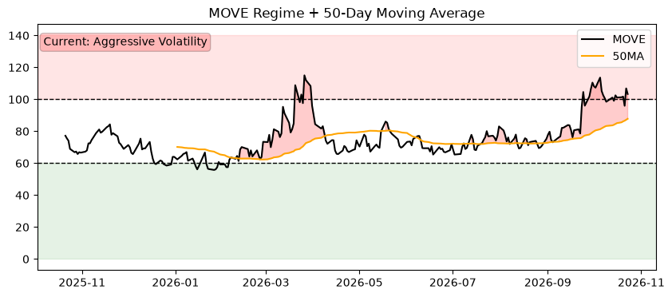
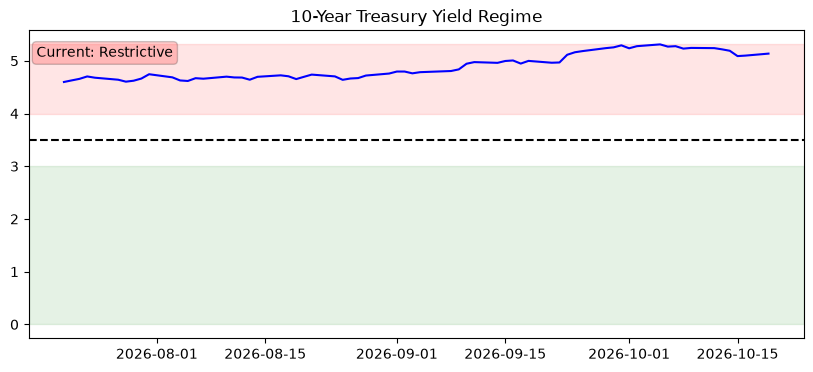
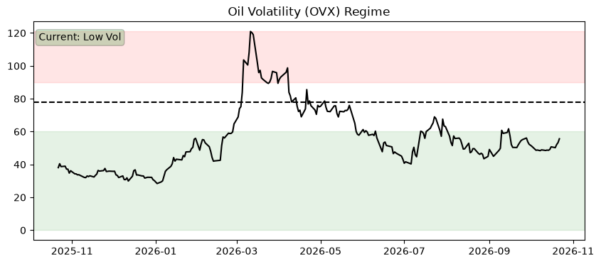
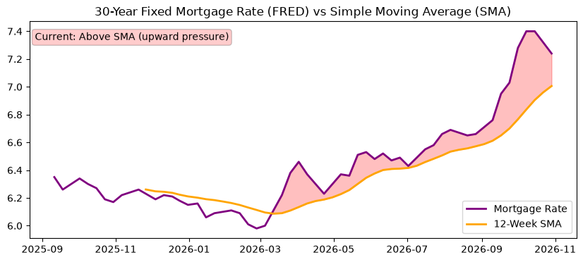
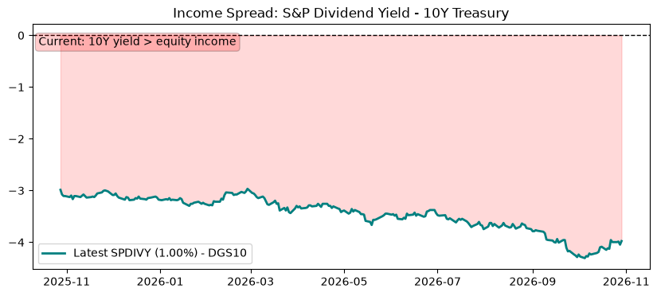

# Market Risk Monitor

**🟢 Recovery**  
**Score:** Downturn 0/3 | Recovery 2/3  
**Last Updated:** 2026-10-21

---

⚠️ **Disclaimer**

This is an automated market signal summary for informational purposes only.
It is not financial advice.

A note from the author:
There are hundreds of resources on the Internet in addition to learning resources available through your investment platform.
For example, [this one by Ramit Sethi](https://youtu.be/FF5-FbhaAyc?si=52cXbGUBFqxifu7Q), or [this one by Jaspreet Singh](https://youtu.be/qdqLIjszqy4?si=-R0Sa7C_Q0bCHY08), or [this one by Erin Moriarity](https://youtu.be/FYMfX3Aljow?si=MPQ7nICG0nA1U6vh), or articles like [this one by Fidelity](https://www.fidelity.com/learning-center/smart-money/roth-ira-taxes).
Seek out the information you need for your future self!

---

## AI Risk Commentary

- SPY price (769.05) exceeds its 200-day moving average (725.87) by 43.18 points (5.95%), placing the index above its long-term trend reference
- QQQ price (717.63) sits 2.81 points (-0.39%) below its 100-day moving average (720.44), placing the index below its medium-term trend reference
- ARKK three-month return of +12.99% reflects cumulative price appreciation over a 63-trading-day window
- VIX level of 17.31 implies a 30-day expected S&P 500 volatility of approximately 17.31% annualized
- TNX yield of 5.15% establishes the annualized risk-free discount rate baseline for present-value calculations
- OVX level of 52.11 with "low" regime indicates crude oil implied volatility is at the lower end of its historical range
- Mortgage rate: null; condition: Unknown
- Income spread: SP dividend yield (0.98%) minus 10-year yield (5.15%) equals -4.17%; the negative spread indicates the 10-year Treasury yield exceeds the S&P 500 dividend yield by 417 basis points, favoring bonds for current income

**Synthesis:** The equity complex shows divergent trend alignment: SPY trades above its 200-day average while QQQ trades below its 100-day average. ARKK's 12.99% three-month gain represents a distinct price trajectory from the major indices. The 5.15% TNX yield exceeds the SPY dividend yield by 4.17%, creating a mathematical income advantage for Treasuries over equities. VIX at 17.31 and OVX at 52.11 (low regime) indicate moderate equity volatility expectations and low energy volatility expectations respectively. Mortgage data is unavailable. Raw data available in /data.

---

## Charts

### SPY Trend

### QQQ Trend

### ARKK Drawdown

### VIX

### MOVE

### 10Y Yield

### Oil Volatility

### Mortgage Conditions

### SPY Trailing Dividend Yield (proxy)

---

[View raw data](data/market_snapshot.json)

---

## RSS Feed

https://raw.githubusercontent.com/krss-llc/market-summary/refs/heads/main/docs/feed.xml

---

## Data

- Signals: [data/signals.json](data/signals.json)  
- History: [data/history.json](data/history.json)
