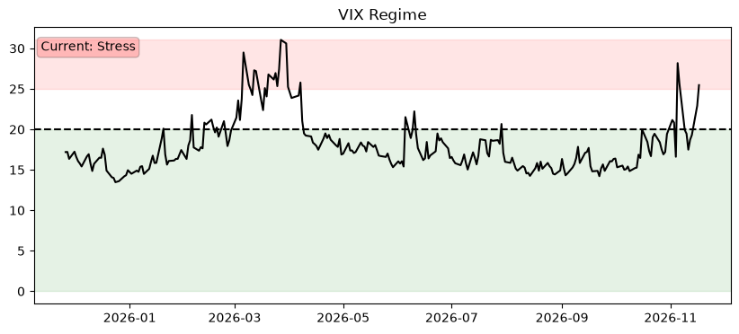

# Market Risk Monitor

**🔴 Downturn Risk**  
**Score:** Downturn 3/3 | Recovery 0/3  
**Last Updated:** 2026-11-21

---

⚠️ **Disclaimer**

This is an automated market signal summary for informational purposes only.
It is not financial advice.

A note from the author:
There are hundreds of resources on the Internet in addition to learning resources available through your investment platform.
For example, [this one by Ramit Sethi](https://youtu.be/FF5-FbhaAyc?si=52cXbGUBFqxifu7Q), or [this one by Jaspreet Singh](https://youtu.be/qdqLIjszqy4?si=-R0Sa7C_Q0bCHY08), or [this one by Erin Moriarity](https://youtu.be/FYMfX3Aljow?si=MPQ7nICG0nA1U6vh), or articles like [this one by Fidelity](https://www.fidelity.com/learning-center/smart-money/roth-ira-taxes).
Seek out the information you need for your future self!

---

## AI Risk Commentary

- SPY price (689.81) sits 5.86% below its 200-day moving average (732.76), indicating price below the long-term trend line
- QQQ price (608.45) sits 14.38% below its 100-day moving average (710.68), showing a wider deviation from the medium-term trend than SPY
- ARKK three-month return of -25.65% reflects significant drawdown in high-duration growth equities
- VIX at 35.89 implies elevated expected 30-day S&P 500 volatility (annualized)
- TNX yield at 4.91% sets the annualized risk-free discount rate baseline for equity valuation models
- Mortgage rate at 7.28% with condition "Unfavorable" represents a 237 basis point spread over TNX, increasing borrowing costs for housing credit
- Income spread: S&P dividend yield (1.1%) minus 10-year yield (5.04%) equals -3.94%; the negative spread favors bonds over equities on a current yield basis
- OVX at 54.12 with regime "low" indicates oil volatility index level relative to its historical range

**Synthesis:** The mathematical configuration shows equity prices (SPY, QQQ, ARKK) trading below their respective moving averages while the annualized risk-free rate (TNX 4.91%) exceeds the S&P 500 dividend yield (1.1%) by 3.94 percentage points. This yield differential increases the discount

---

## Charts

### SPY Trend

### QQQ Trend

### ARKK Drawdown

### VIX

### MOVE

### 10Y Yield

### Oil Volatility

### Mortgage Conditions

### SPY Trailing Dividend Yield (proxy)

---

[View raw data](data/market_snapshot.json)

---

## RSS Feed

https://raw.githubusercontent.com/krss-llc/market-summary/refs/heads/main/docs/feed.xml

---

## Data

- Signals: [data/signals.json](data/signals.json)  
- History: [data/history.json](data/history.json)
